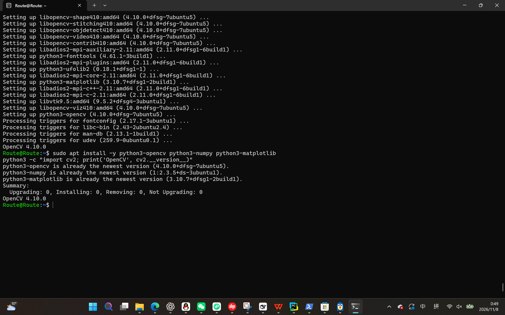
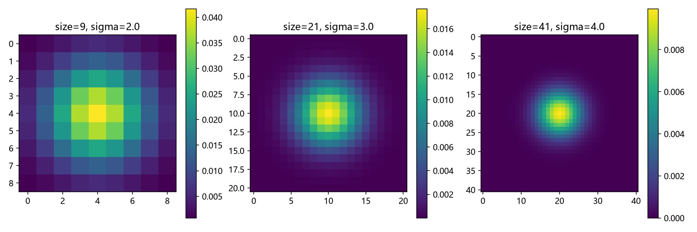
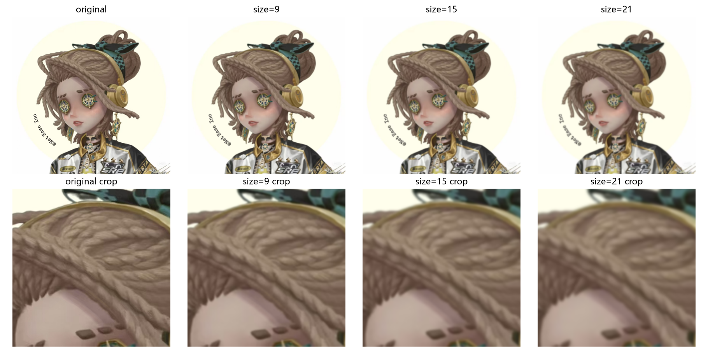
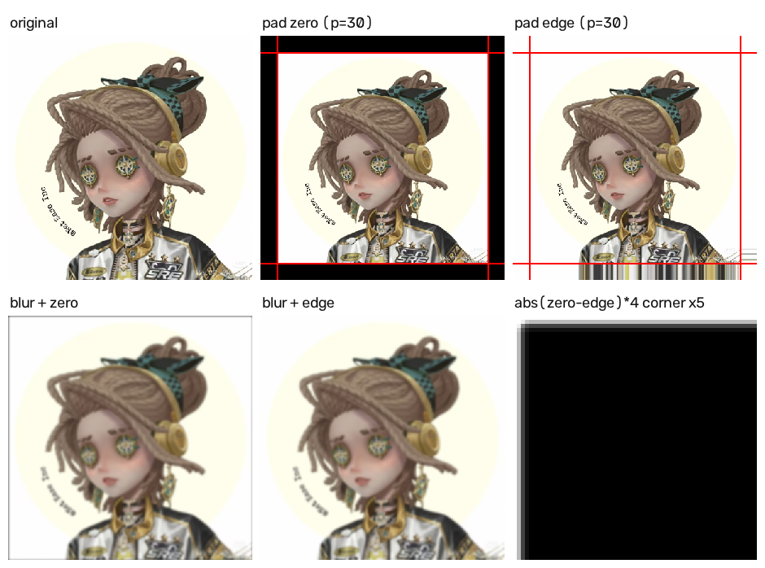

## 这是黄政的cv作业。
班级：计算机越杰2601
分别实现四个任务：
## 1.ubuntu的下载和安装opencv库。
在美国程序员的悉心教导下我成功装好了.详见任务1截图。

## 2.手写滤波核，并且与opencv的核对比

    2.1.朴素写法：纯粹的模拟。
        对于二维坐标(x,y),计算出对应的高斯公式exp-(x^2+y^2)/2sigma^2并且记录，
        记录总和sum.
        归一化，对每一个计算好的核值除以sum，保证总和为1.
        很显然复杂度为O(n^2)

    2.2.外积求解。
        由于指数运算本身的性质，
        exp-(x^2+y^2)/2sigma^2可以分解成exp(-x^2)/2sigma^2*exp(-y^2)/2sigma^2 
        也就是说，二维核k[i][j]就可以写成一维的核g[i]*g[j]
        复杂度变为O(n).

    2.3.与opencv的核对比
        发现差值完全只是浮点数的位数导致的，可以忽略。说明手写成功。

## 3.手写高斯滤波并且使用不同的size和sigma

    3.1.高斯滤波，
        对于新图的一个像素，其值为原图上周围的（size*size）个像素值与对应核值乘积求和。
        朴素写法：按照定义，设原图大小n*n,核大小m*m,则四层循环，复杂度为O（n*n*m*m)
        优化写法：同样利用指数运算的性质，将（m*m）次加法分解成（m+m）次乘法，则总的运算量变为O（n*n*吗）
    3.2.不同的size和sigma
        要求计算核和高斯滤波的过程必须可以打包为一个函数。
    但是在py中可以轻松地实现，把数组传来传去，非常友好。

## 4.实现两种padding

    4.1边缘复制
        字面意思，边缘新像素就去复制最近的原图上的像素。
    4.2边缘全黑
        灰度值为0即为全黑，也就是高斯滤波的时候，如果越界直接记成0

以上。

written by Route,completely handmade.

thanks for reading!