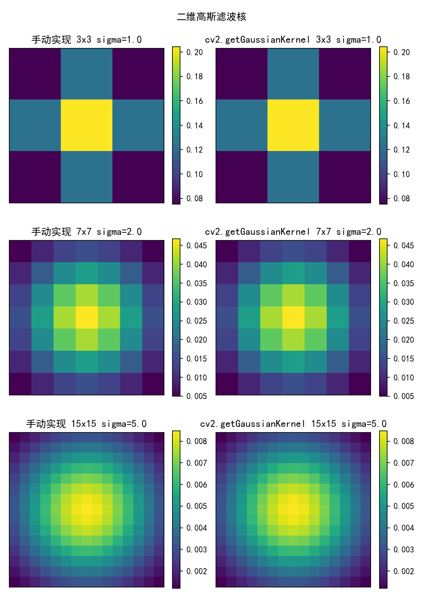
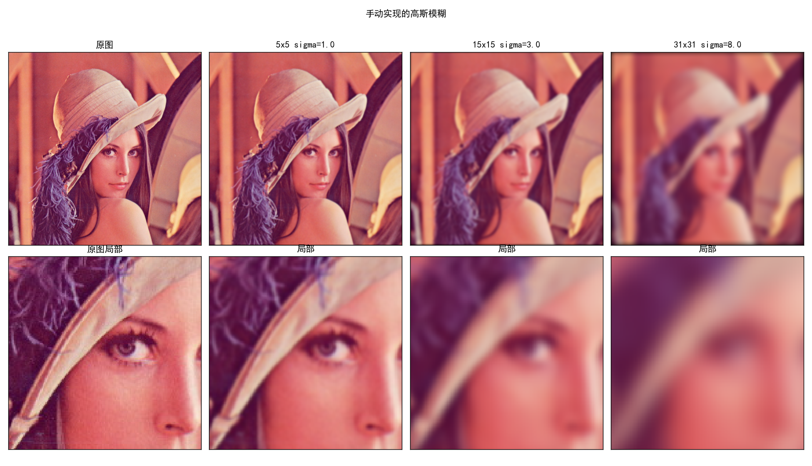
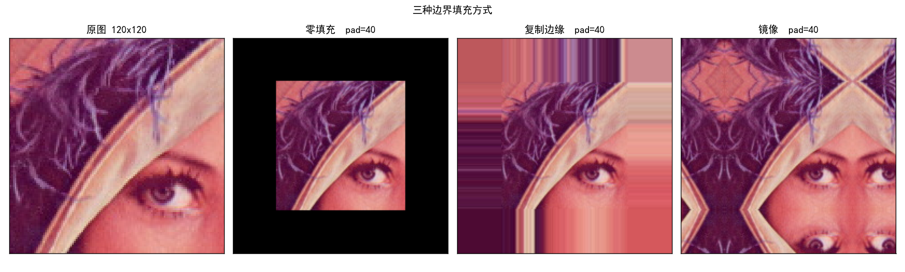
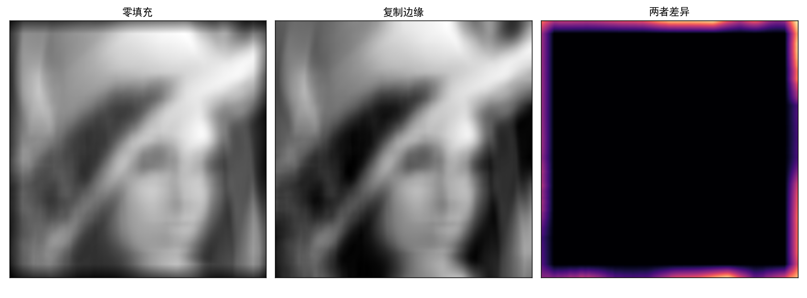

# 作业二 图像滤波

## 环境

装了 Ubuntu 22.04 + python3.10，opencv 直接用 pip 装的：

```bash
pip install opencv-python matplotlib numpy
```

版本是 opencv 5.1.0、matplotlib 3.10、numpy 2.2。

## 运行

```bash
cd hw2
python gauss_kernel.py
python filter.py
python padding.py
```

三个脚本各自独立，都会把图存到 `results/` 下面，也会顺手 plt.show 弹出来。
测试图用的是 `images/lena.jpg`，512x512。

## 文件说明

- `gauss_kernel.py` —— 任务2。按二维高斯函数手写了一个核，和 `cv2.getGaussianKernel` 生成的核放在一起对比，试了 3x3/σ=1、7x7/σ=2、15x15/σ=5 三组，打印了两者的最大误差（都在 1e-17 量级，基本就是浮点误差）。
- `filter.py` —— 任务3。自己写了个卷积，对三个通道分别卷一遍，用 5x5、15x15、31x31 三个核做高斯模糊。下面是整图和局部放大的对比，局部截的是眼睛那块，参数差别看得比较清楚。
- `padding.py` —— 任务4。写了零填充和复制边缘两种，还有一个镜像，一共三种（要求两种就够了，镜像顺手加的）。先单独看填充出来的结果，再拿 31x31 的均值核试了零填充和复制边缘，看滤波之后边界的差别。

## 结果

任务2，高斯核对比：



任务3，不同核大小和 σ 的模糊结果：



任务4，三种填充方式：



填充方式对滤波边界的影响，右边那张是两条结果的差，只有边上一圈有区别：



## 一些结论

核越大、σ 越大，图越糊，这个和预想一样。用 31x31 的大核时零填充的边上会明显发黑，因为边外面全是 0，参与平均之后把边缘拉暗了；复制边缘就没这个问题。
